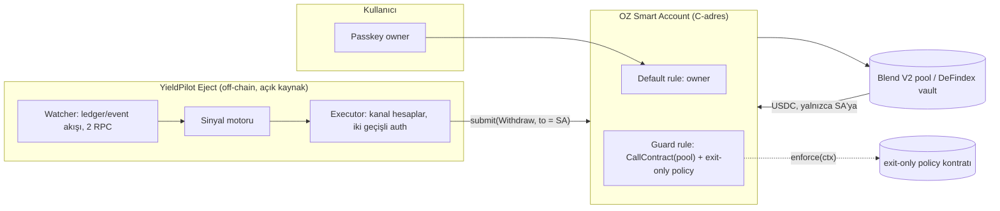

# SCF Build Award planı — YieldPilot pivotu: "fırlatma koltuğu" (exit guard)

- **Tarih:** 26 Ekim 2026
- **Hedef:** Stellar Community Fund 7.0 Build Award, **Open Track**, yaklaşık **$75K** (bant $70–85K)
- **Kaynak:** [lumenloop/awesome-stellar-community-fund](https://github.com/lumenloop/awesome-stellar-community-fund) rehberleri (SCF 7.0 Guide, Tips for Applying, Writing Deliverables/Budgets, prescreen ve reviewer skill'leri) + SCF sitesi + web araştırması

---

## 1. Karar

YieldPilot'ı bugünkü haliyle ("en yüksek APY'li Blend havuzuna otomatik taşıyan ajan") başvurmak zayıf. Sebepler aşağıda (§2). Önerim, aynı altyapıyı kullanıp ürünü **getiri kovalamaktan pozisyon korumaya** çevirmek:

> **YieldPilot Eject:** Stellar DeFi pozisyonlarınız için otonom bir fırlatma koltuğu. Havuzda bir saldırı ya da sağlıksızlık sinyali görünce parayı **sizin kendi hesabınıza** çeker. Ajanın yetkisi zincir üstünde "yalnızca kendine çek" ile sınırlıdır. Anahtarı çalınsa bile en kötü sonuç, paranızın kendi cüzdanınıza dönmesidir.

Ürün adı YieldPilot kalır, çünkü pilot ile fırlatma koltuğu metaforu birbirini tutuyor. Ayrıca Ekim 2026'daki isim değişikliğinin kimlik maliyetini (DB adı, demo-owner seed) tekrar ödemeyiz.

### Ekip ve SCF geçmişi

- **Göktuğ Oğuz Güngör:** İş Bankası'nda çalışıyor. YieldPilot'ın bu proje için aldığı Instaward'ın sahibi.
- **Melike Keçelioğlu:** Hourglass Protocol ile Instaward almış.
- **Bu, ekibin ilk SCF Build Award başvurusu.** 3 ret / 3 tur yasağı riski yok.

Bunun başvuruya etkileri:

1. **Instaward en güçlü "track record" kanıtımız.** Rehberin istediği "Stellar'da daha önce iş teslim ettik" kanıtı bu. Başvuruda iki Instaward da sprint çıktılarıyla birlikte yazılır: neyin teslim edildiği ve linkleri.
2. **Önce Instaward sprint'leri kapanmalı.** Prescreen'de "outstanding unfulfilled grants" uygunluk kontrolü var. Instaward'da ilerleme "agreed deliverables"a göre ölçülüyor. Build Award gönderilmeden önce iki sprint de Chapter Lead tarafından kabul edilmiş olmalı.
3. **Pivotu Instaward hikâyesinin devamı olarak anlatmak.** Instaward YieldPilot'ın getiri ajanı için alındı. Anlatı şöyle kurulur: "Instaward sprint'inde kullanıcı başına smart account yürütmesini ve 97 cüzdan testini teslim ettik. Sertleştirirken ajan yetkisindeki açığı bulduk, YieldBlox olayını inceledik ve ürünü korumaya çevirdik." Bu bir chain-hop değil, öğrenilmiş bir evrim. **Pivotu önce Chapter Lead ile konuşmak gerek**, çünkü projeyi onaylayan ve doğal referrer'ımız olan kişi o.
4. **Referral.** Ambassador'lar onaylı referrer olabiliyor. Chapter Lead onaylı ve onboard edilmiş bir referrer'sa, Interest Form'a girilecek referral kodunu ondan istemek gerekir. Referral avantaj sağlamaz ama ekibi tanıtır ve bağlam ekler.
5. **Follow-on Instaward.** Kurallar en fazla 2 follow-on disbursement'a izin veriyor (toplam üst sınır $15K, ayrı ve iyi kapsamlanmış bir sprint şartıyla). §7'deki exit-only policy spike'ı ve YieldBlox replay'i tam olarak 30 günlük böyle bir sprint. Bu sprint follow-on Instaward ile fonlanabilir. Instaward'ın Build Award ömür boyu üst sınırına sayılıp sayılmadığı kurallarda yazmıyor, ama ~$75K'lık talepte bu fark etmez.
6. **İşveren ve zaman taahhüdü.** Reviewer'lar ekibin ne kadar zaman ayıracağına bakar. Göktuğ tam zamanlı çalışıyorsa bütçede efor yarı zamanlı ve dürüst yazılmalı. Bankacılık deneyimi risk motoru ve kurumsal hazine personası için güçlü bir kredi. Ancak başvuruda İş Bankası bir kurum ya da ortak gibi gösterilmemeli, yalnızca kişisel deneyim olarak yazılmalı. Ayrıca iş sözleşmesinin ücretli dış iş ve kripto faaliyetine izin verdiği teyit edilmeli, çünkü ödül KYC sonrası kişiye ödeniyor.
7. **Hourglass'ın konumu netleşmeli.** Melike Hourglass'a devam ediyorsa zamanının ne kadarını buraya ayıracağı yazılmalı. İki proje birleşiyorsa ilişki başvuruda açıkça anlatılmalı. Prescreen'de "aynı proje farklı isimle" kontrolü var.

---

## 2. Teşhis: bugünkü repo SCF gözüyle

| # | Sorun | Neden zarar verir (rehberdeki kural) | Çözüm |
|---|---|---|---|
| 1 | **Güvenlik iddiası yanlış.** `addAgentRuleOps` (`src/lib/smartAccount.ts:488-507`) pool kuralını **policy'siz** kuruyor. Ajan anahtarı `pool.submit`'i herhangi bir `to` ile ve herhangi bir istek tipiyle (Borrow dahil) çağırabilir. USDC kuralında tavan var (5.000 USDC/gün) ama hedef adres kısıtı yok. Oysa `yieldpilot-urun-aciklamasi.md` "ajan paranızı dışarı çıkaramaz" diyor. | Reviewer'lar her iddiayı doğrular ("verify every claim"). Audit Bank bunu ilk günde bulur. Doğrulanamayan güvenlik iddiası güveni bitirir. | Argümanları denetleyen, "yalnızca kendine çek" kuralını uygulayan **özel bir Soroban policy kontratı** (§4). USDC kuralı tamamen kalkar. |
| 2 | **Demo-owner fiilen emanetçi (custodial).** Her smart account'un owner anahtarı `AGENT_SIGNER_SECRET`'tan türetiliyor (`agentKeys.ts`). Yani sunucu her hesabın sahibi. | "Handle key management explicitly." Non-custodial iddiası bununla çelişiyor. | Owner rolü passkey'e (OZ WebAuthn verifier) geçer. Kullanıcı kuralları kendi imzalar. |
| 3 | **Ana entegrasyon listeden çıkmış.** Blend v2, Integration List'ten "geçici olarak çıkarıldı". | Integration Track'te Blend artık seçilemez. Saf Blend APY optimizasyonu da zamanlama açısından kötü. | Open Track. Değer önerisi Blend'in *riskini azaltmak* olunca liste dışı olmak sorun olmaktan çıkar, bir gerekçeye dönüşür. |
| 4 | **Farklılaşma zayıf.** DeFindex (Palta Labs, Integration List'te) cüzdanlara "vault + strateji yönetimi"ni zaten sunuyor. Mainnet'teki birkaç Blend USDC havuzu arasında en yüksek APY'yi seçmek küçük bir karar uzayı. | "Uniqueness: if competitors exist, clear differentiation." | Pivot: korumayı kimse kullanıcı tarafında yapmıyor (§5). |
| 5 | **"AI ajanı" söylemi gerçekle uyuşmuyor.** Ürün dokümanı "Claude karar verir" diyor. Kod deterministik, LLM yok. | Tutarsızlık reviewer güvenini düşürür. Buzzword'ler de puan kaybettirir. | "Deterministik, zincir-üstü yetkiyle sınırlı otonom ajan." Dürüst ve daha güçlü. |
| 6 | **README tek satır**, LICENSE yok, mimari diyagram yok. | Prescreen reviewer'ı GitHub'a bakınca boş sayfa görür. "Smart contracts must have an open-source plan." | README, Apache-2.0, Mermaid diyagram, demo videosu, canlı testnet linki. |
| 7 | **Kendi Soroban kontratımız yok.** Sadece OZ ve Blend kontratlarını çağırıyoruz. | Open Track: "Show Soroban-native design", "No Soroban usage" kırmızı bayrak. | Exit-only policy, projenin çekirdek kontratı olur. |
| 8 | **Yürütme mimarisi korumaya uygun değil.** Vercel'deki günlük cron tick ve tek kaynak hesap (sequence çakışması) var. | Saniyeler içinde tepki gerekiyor. Günlük tick işe yaramaz. | Uzun ömürlü bir watcher worker, ledger/event akışı ve kanal hesaplar (paralel tx). |
| 9 | **Traction yok.** 97 cüzdanlık testnet yük testi teknik bir kanıt, kullanıcı kanıtı değil. Repoda ekip bilgisi yok. ETHGlobal finalistliğinin linki yok. | "Named, credible team", "evidence of demand". | Ekip (§1) ve iki Instaward'ın çıktıları README'ye. Blend tedarikçileriyle görüşmeler, waitlist ve en az 1 cüzdan veya DAO'dan LOI. |

---

## 3. Neden bu pivot

- **Gerçek, yakın tarihli, ölçülmüş bir acı var.** Şubat 2026'daki YieldBlox olayında Blend V2 üzerinde topluluk tarafından işletilen bir havuz, likiditesi neredeyse sıfır olan USTRY/USDC piyasasında tek bir işlemle (~$1 → ~$106) manipüle edildi ve **~$10.2M** boşaltıldı. Reflector VWAP penceresi 300 saniye. Manipüle fiyat iki ardışık güncellemede kaldı ve sapma kontrolü onu "değişim yok" diye geçirdi. Bunun $7.2M'ı validator'lar tarafından donduruldu. Yani DEX işlemi ile boşaltma arasında **dakikalar** vardı. Bu süre kullanıcı tarafında bir bekçi için yeterli olabilir. Ne kadar yeterli olduğunu §7'deki replay ölçecek, peşinen iddia etmiyoruz.
- **Boşluk var.** Mevcut ve fonlanmış araçlar ya sadece izliyor ya da protokol tarafında çalışıyor. Kullanıcı adına ve güvenli biçimde *harekete geçen* bir şey yok (§5).
- **Elimizdeki zor kısım tam bunu yapıyor.** OZ smart account, context rule, policy signer, iki geçişli simulate ve AuthPayload imzası, kullanıcı başına yürütme döngüsü, Blend reserve okuyucu (utilization, oracle tazeliği), havuz keşfi ve 97 cüzdanlık yük testi altyapısı. Kodun büyük kısmı korunur.
- **SDF'nin 2026 gündemiyle örtüşüyor.** SDF, x402/MPP ile birlikte OpenZeppelin smart account ve programlanabilir harcama limitlerini öne çıkarıyor. SCF #43–44'te bu alanda üç proje fonlandı (§5). Biz onların "harcama" tarafının tersini, yani **koruma** tarafını getiriyoruz.

---

## 4. Yeni ürün: teknik tanım

**Tek cümle:** Blend ve DeFindex'e USDC yatıran kullanıcıların OZ smart account'una "yalnızca kendine çekebilir" yetkili bir bekçi ekleyen, havuz saldırı ve sağlıksızlık sinyallerinde pozisyonu birkaç ledger içinde kullanıcının kendi hesabına çeken açık kaynak koruma katmanı.

### Güven modeli (projenin kalbi)

- **Owner:** kullanıcının passkey'i (OZ WebAuthn verifier). Default rule onda. Kullanıcı istediği an bekçiyi kaldırır.
- **Guard rule:** `CallContract(POOL_i)` + **`exit-only` policy** (yeni Soroban kontratı). Policy çağrı bağlamını (contract, fn_name, args) okur ve yalnızca şunlara izin verir:
  - `fn_name == "submit"`
  - `from == spender == to == smart_account`
  - Tüm request tipleri `{Withdraw, WithdrawCollateral}` içinde (Supply, Borrow ve auction istekleri reddedilir)
- **USDC rule yok.** Withdraw'da token'ı pool kontratı kendisi transfer eder, SA'nın USDC yetkisi gerekmez. Ajan USDC'ye hiç dokunamaz.
- **Sonuç:** Ajan anahtarı ele geçirilse saldırganın yapabileceği tek şey, kullanıcının parasını havuzdan *kullanıcının kendi hesabına* çekmektir. Kaybedilen yalnızca birkaç saatlik getiridir.
- **İlk doğrulanacak varsayım:** OZ `Policy` arayüzünün argümanları okuyup reddedebildiği. `spending_limit` de `transfer` miktarını bu yoldan okuyor. İlk spike bunu testnet'te kanıtlar (§7, iş 3).

### Sinyal motoru (deterministik, LLM yok)

| Sinyal | Kaynak | Örnek eşik (kullanıcı başına preset) |
|---|---|---|
| Oracle sapması | Havuz oracle'ı ile bağımsız referans (Stellar DEX TWAP, ikinci feed) karşılaştırması | > %X ve likidite < Y |
| İnce piyasada anormal işlem | Teminat varlığının DEX işlemleri | Tek işlemde > %Z fiyat sıçraması |
| Utilization sıçraması | Reserve okumaları (mevcut `scanner.ts`) | N ledger içinde > %U artış |
| Ledger başına anormal borrow | Pool `borrow` event'leri | Reserve'in > %B'si |
| Havuz durumu, admin değişikliği | Pool status ve config event'leri | on-ice/frozen, yeni reserve/oracle |
| Backstop çözülmesi | Backstop Q4W event'leri | Eşik üstü çıkış kuyruğu |

### Yürütme

- Uzun ömürlü watcher (RPC `getEvents` ve ledger akışı) iki bağımsız RPC sağlayıcıdan beslenir. Vercel cron'dan çıkılır.
- Sinyal geldiğinde etkilenen havuzdaki tüm korunan hesaplar için **kanal hesaplarla paralel** `submit(Withdraw…)` gönderilir. Mevcut `buildAgentAuth` iki geçişli simulate'i korunur. Ücretler surge-aware ayarlanır.
- v1 kapsamı: **borcu olmayan tedarikçiler.** Borçlu hesaplarda teminat çekimi health check'e takılır. Bu durum v2'ye kalır ve başvuruda açıkça yazılır.

### Mevcut koddan ne kalır, ne değişir

| Kalır | Değişir | Yeni |
|---|---|---|
| `smartAccount.ts` iki geçişli auth, `wallet.ts` policy signer | `addAgentRuleOps`: tek guard rule, USDC rule kalkar | `contracts/exit-only-policy` (Rust/Soroban) |
| `scanner.ts`, `discovery.ts`, `defindex.ts` okuyucular | `orchestrator.ts`: "supply" döngüsü yerine "exit" döngüsü | `signals/` (oracle, DEX, utilization, event) |
| `registry.ts`, `db.ts`, loadtest altyapısı | Onboarding: demo-owner yerine passkey | Incident replay harness |
| Plate UI (APY yerine havuz sağlığı gösterir) | `runtime.ts`: cron yerine watcher worker | Bildirimler, public status sayfası |

Getiri yönlendirme (`bestPool`) repoda kalır ama **SCF kapsamının dışında** tutulur. Gelecekteki "re-entry" modu için not edilir. Kapsamı dar tutmak bilinçli bir tercih.

---

## 5. Rakipler ve komşular

| Proje | Ne yapıyor | Bizden farkı |
|---|---|---|
| Orion (SCF) | Blend, Aquarius, Soroswap ve FxDAO'da maruziyet ve risk sinyali API'si | İzliyor, harekete geçmiyor. Sinyal kaynağı olarak kullanılabilir. |
| Dig (SCF başvurusu) | DeFi dashboard, Blend pozisyon izleme | İzleme |
| DeRisk (SCF #20, $50K) | Lending protokolleri için erken uyarı | Protokol tarafı, uyarı |
| Stellar Oracle Shield (Sun Zu Lab) | Protokollerin sorgulayacağı oracle sağlık kontratı | Protokol tarafı circuit breaker. Tamamlayıcı, sinyal olarak tüketilebilir. |
| Blockaid | Ağ ve cüzdan seviyesinde tehdit tespiti (YieldBlox'ta karantina) | Kullanıcı pozisyonunu çekmez |
| DeFindex keeper / emergency manager | Vault seviyesinde strateji kurtarma | Yalnızca DeFindex vault yatırımcıları, vault yöneticisinin takdiriyle. Doğrudan Blend pozisyonları korumasız. |
| Policywright ($55K, SCF #44), OZ Accounts Policy Builder / Gateway.fm ($98K, SCF #44) | Kayıttan least-privilege OZ policy üretimi (dev tooling) | Tamamlayıcı. Bizimki belirli bir son-kullanıcı ürünü ve denetlenebilir somut bir policy. |
| REAPP ($70K, SCF #43) | x402 için harcama mandası (bütçe ve dönem limiti) | Harcama tarafı. Biz koruma ve çıkış tarafıyız. |
| EVM: Hypernative, Forta Firewall, GuardAI (hackathon) | EVM'de benzer guardian fikirleri | Stellar'da yok. Bizimki Reflector ve Blend'e özgü hata modlarını ve OZ Stellar smart account'larını hedefliyor. |

**"Neden Stellar?" cevabı:** Soroban'da hesap soyutlaması protokol seviyesinde (`__check_auth`). OZ Stellar smart account'larının context rule ve argüman denetleyen policy modeli, "yalnızca kendine çek" yetkisini zincir üstünde zorlamayı mümkün kılıyor. ~5 sn finality, ledger bazlı tepkiyi anlamlı kılıyor. Hedeflediğimiz hata modu Stellar'a özgü: Reflector VWAP penceresi ve Stellar DEX'teki ince piyasalar.

---

## 6. Track, bütçe, milestone'lar

**Track: Open Track.** Yeni bir zincir-üstü primitif (exit-only policy) ve bunun etrafında kompozisyonel bir koruma katmanı var. Blend listede olmadığı ve proje bir building block'u son kullanıcıya taşımadığı için Integration Track uygun değil. Open Track topluluk oylamasına (NQG) gidiyor. §7'deki topluluk işleri bu yüzden zorunlu.

**Süre:** ~4,5 ay (6 ay sınırının altında). **Bütçe:** ~$75K, aşağıdan yukarı. Audit hariç (Audit Bank ayrı başvuru). Pazarlama, hukuk ve geçmiş iş yok. Yedek bütçe ≤%5.

| Rol | Efor | Haftalık | Tutar |
|---|---|---|---|
| Soroban/Rust geliştirici (policy, testler, audit düzeltmeleri) | 8 hf | $4.000 | $32.000 |
| Full-stack (watcher, sinyaller, executor, passkey onboarding, dashboard) | 10 hf | $3.500 | $35.000 |
| UI/UX (part-time) | 3 hf | $2.000 | $6.000 |
| Altyapı (2 RPC sağlayıcı, 2 bölge worker, 6 ay) | — | — | $2.000 |
| **Toplam** | | | **$75.000** |

Tranche'lar sabit: T0 $7.5K (onayda) / T1 $15K / T2 $22.5K / T3 $30K.

**Roller henüz kişilere atanmadı.** Rollerin kime düşeceği Göktuğ'un ve Melike'nin becerilerine ve haftalık saatlerine bağlı. Örneğin Göktuğ %50 çalışıyorsa full-stack satırı "20 hf × %50" diye yazılır ve takvim buna göre uzar. Ekipte kimsenin karşılamadığı bir rol (örneğin UI/UX) varsa bu kişi bütçede "yüklenici" olarak gösterilir. Rakamlar gerçek saatlerle `scf-budget-builder` skill'inden geçirilecek.

### T1 — MVP (Stellar ile etkileşen gerçek kod)
1. **Exit-only policy v1.** Rust/Soroban kontratı, ≥%90 satır kapsamalı unit ve property testleri, testnet deploy. *Tamamlanma:* kontrat adresi ve repo. Testnet'te izinli çağrı (Withdraw → SA) geçer. Yasaklı dört çağrı (Borrow, Supply, `to ≠ SA`, USDC transfer) reddedilir. Dört tx hash'i paylaşılır.
2. **Guard engine v1.** Watcher, 4 sinyal (oracle sapması, DEX sıçraması, utilization, havuz durumu) ve executor. *Tamamlanma:* kendi testnet havuzumuzda mock oracle ile sahnelenen saldırıda bekçinin kaç ledger'da çektiği video ve tx hash'leriyle gösterilir.
3. **Incident replay harness.** YieldBlox mainnet ledger'larını (Hubble/BigQuery veya arşiv RPC) tekrar oynatır. *Tamamlanma:* yayımlanmış rapor ve tekrarlanabilir script. "Sinyal ilk hangi ledger'da tetiklenirdi, boşaltma hangi ledger'daydı" sorusuna cevap verir.

### T2 — Testnet (tam özellik, harici kullanıcılar)
1. **Passkey ile non-custodial onboarding.** Demo-owner tamamen kalkar. *Tamamlanma:* yeni hesapta owner = WebAuthn signer, sunucuda owner anahtarı yok (kod ve on-chain okuma ile kanıtlanır).
2. **Çoklu pozisyon.** Tüm Blend V2 havuzları ve DeFindex vault withdraw desteği, kullanıcı başına hassasiyet presetleri.
3. **Dashboard ve bildirimler.** Plate UI'da havuz sağlığı, e-posta/Telegram uyarıları, public status sayfası.
4. **Ölçek testi.** Mevcut 97 cüzdan altyapısı "çıkış gecikmesi" için yeniden koşulur. *Tamamlanma:* sinyalden tüm çıkışların zincire inmesine kadar p50/p95 ledger raporu. ≥25 harici testnet kullanıcısı.

### T3 — Mainnet (kullanılabilir lansman)
1. **Audit düzeltmeleri ve mainnet deploy.** Audit Bank raporundaki bulgular kapatılır. Policy mainnet'e deploy edilir, wasm hash doğrulanabilir, Apache-2.0.
2. **Üretim bekçisi.** 2 bölge, 2 RPC, izleme, alarm ve runbook, açık sinyal feed API'si.
3. **SDK ve dokümanlar.** `@yieldpilot/eject` npm paketi, böylece cüzdanlar guard rule'u kendi SA akışlarına gömebilir. Quickstart ve en az 1 cüzdan veya uygulama entegrasyonu (LOI'den canlıya).
4. **Go-live metrikleri.** Lansmandan 60 gün sonra hedef: ≥100 korunan hesap ve ≥$250K korunan TVL. Gerçekçiliği §7'deki talep görüşmeleriyle kalibre edilir.

---

## 7. Başvurudan önce yapılacaklar

Bu işler fonlanmaz (geçmiş iş geri ödenmez) ama Interest Form'u ve prescreen'i geçirecek kanıt bunlardır. T1, buradaki spike'ların üretim sürümüdür.

### Benim yapacaklarım (repo içinde)

| # | İş | Süre |
|---|---|---|
| 1 | **Dürüstlük düzeltmesi.** README ve ürün dokümanındaki "ajan paranızı çıkaramaz" ve "Claude karar verir" iddialarını düzelt. Mevcut güven modelini olduğu gibi yaz. | 0,5 gün |
| 2 | **README, LICENSE (Apache-2.0), Mermaid mimari, "Why Stellar" bölümü** | 1 gün |
| 3 | **Exit-only policy spike.** Minimal Rust kontratı, testnet deploy, izinli ve yasaklı çağrıların tx hash'leri. OZ Policy'nin argüman okuyabildiği varsayımını kanıtlar. | 3–4 gün |
| 4 | **Guard rule onboarding.** `addAgentRuleOps` yerine tek guard rule, USDC rule'suz. Exit döngüsü için ilk orchestrator dalı ve testleri. | 2 gün |
| 5 | **YieldBlox replay v0.** Olay ledger'larının zaman çizelgesi (DEX işlemi, oracle güncellemeleri, borrow'lar) ve basit oracle-sapması sinyalinin ilk tetiklendiği an. Tek sayfalık rapor. | 3 gün |
| 6 | **Demo.** Testnet'te sahnelenen saldırı ve çekim, 2 dakikalık video ve canlı demo linki | 1 gün |
| 7 | **Başvuru taslakları.** Interest Form, ardından Build Award. awesome-scf skill'leri (`scf-interest-form-drafter`, `scf-submission-drafter`, `scf-budget-builder`) ile taslak, `scf-prescreen-checker` ve `scf-reviewer` ile öz denetim. | 1–2 gün |

### Senin yapman gerekenler (yalnızca sen yapabilirsin)

- **Instaward:** iki sprint'in kabul edilmiş deliverable'ları ve linkleri. Hâlâ açık bir şey varsa önce o kapatılır.
- **Chapter Lead ile görüşme:** pivot, referral kodu ve follow-on Instaward (spike + replay sprint'i).
- **Ekip bilgisi:** iki kişinin rolleri, becerileri ve haftalık saatleri. GitHub/LinkedIn linkleri. ETHGlobal finalistliğinin doğrulanabilir linki. İş sözleşmesinin dış işe izin verdiğinin teyidi.
- **Hourglass:** ne yaptığı ve bu projeyle ilişkisi (ayrı mı devam ediyor, birleşiyor mu).
- **Talep kanıtı:** Blend ve YieldBlox tedarikçileriyle 10–15 görüşme (Blend Discord, Stellar Dev Discord). Waitlist sayısı ve toplama süresi. Bir cüzdan, DAO hazinesi veya fon yöneticisinden LOI.
- **Topluluk:** Stellar Dev Discord `#scf-general`'da fikri paylaşıp geri bildirim almak. **Blend (Script3) ekibiyle erken görüşmek**, çünkü toplu çıkışın "bank run" etkisi kaygısını onlarla birlikte yanıtlamak gerek (§9). Bir referrer kodu (Ambassador, Pilot, alumni).
- **İsim kararı:** "YieldPilot Eject" mi, başka bir ad mı?

---

## 8. Takvim

- **SCF #46:** Build submission son günü **8 Kasım 2026**. Panel 11–18 Kasım, oylama 23 Kasım–3 Aralık. Interest Form onayı ve davet olmadan Build Award gönderilemiyor. Davetler rolling. #46 ancak davet çok hızlı gelirse mümkün, bu yüzden plan buna dayanmamalı.
- **Gerçekçi hedef: SCF #47** (tarihleri henüz doğrulanamadı).
  - **1. hafta:** iş 1–4. Interest Form, policy spike'ının tx hash'leriyle birlikte gönderilir.
  - **2. hafta:** iş 5–6, Discord ve Blend görüşmeleri, referral.
  - **Davet gelince:** Build Award taslağı, prescreen simülasyonu, dış okuyucu, gönderim.
- **Ön koşul:** iki Instaward sprint'i kapanmış ve Chapter Lead pivottan haberdar olmalı. Bu adım 1. haftanın başında yapılır.
- **Follow-on Instaward:** spike ve replay işi ayrı bir 30 günlük sprint olarak Chapter Lead'e önerilir. Kabul edilirse bu iş fonlanır ve teslimi Build Award'da ikinci bir track record kanıtı olur.

---

## 9. Riskler ve dürüst cevaplar

| Risk | Cevap |
|---|---|
| Bekçi gerçek bir saldırıda yetişemeyebilir (utilization %100 olunca çekim yapılamaz) | Replay raporu bunu ölçer. Sonuç ne çıkarsa yazılır. Değer önerisi "erken çıkış" olarak kurulur, "garanti" vaat edilmez. |
| Toplu çıkış havuzda bank-run etkisi yaratabilir | Yalnızca sert sinyallerde tetiklenir. Kullanıcı başına presetler ve kademeli çıkış var. Blend ekibiyle eşik tasarımı yapılır, false-positive oranı replay ve testnet'te raporlanır. |
| False positive kaçan getiriye mal olur | Maliyet birkaç saatlik getiri. Kullanıcı tek tıkla geri yatırır (owner imzasıyla). |
| Ajan veya sunucu ele geçirilirse | Exit-only policy sayesinde en kötü durum, paranın kullanıcının kendi hesabına dönmesi. Bu iddia başvurunun merkezinde ve testlerle kanıtlanıyor. |
| OZ Policy argüman denetimine izin vermezse | İlk spike (iş 3) bunu 1. haftada netleştirir. Olmazsa B planı: guard rule'u SA yerine ince bir "exit router" kontratına `CallContract` ile bağlamak. Router argümanları kendisi sabitler. |
| Open Track topluluk oyuna bağlı | Erken Discord varlığı, açık replay raporu ve Blend ekibinin görüşü. Güvenlik konusu oyda anlatması kolay bir konu. |

---

## 10. Değerlendirilen alternatifler

- **B — x402/agent hazinesi için DeFindex'e otomatik süpürme (Integration Track, DeFindex listede).** Zamanlama iyi, ama Stellar'da x402 satıcı sayısı henüz düşük (traction kanıtı zor) ve DeFindex'in kendi ürününe yakın. İkinci tercih.
- **C — Bugünkü getiri optimizasyonunu DeFindex ve Etherfuse stablebond'larıyla tüketici tasarruf uygulamasına çevirmek (Integration Track).** Beans, Figo, Prism, For Yield gibi oyuncularla kalabalık bir alan. Önerilmez.
- **D — Değiştirmeden başvurmak.** §2'deki 1, 3, 4 ve 7. maddeler büyük olasılıkla prescreen veya panelde düşürür. Önerilmez.

---

## Kaynaklar

- [awesome-stellar-community-fund](https://github.com/lumenloop/awesome-stellar-community-fund): `docs/scf-7-guide.md`, `docs/tips-for-applying.md`, `docs/writing-deliverables.md`, `docs/writing-budgets.md`, `docs/rfp-response-guide.md`, `skills/scf-prescreen-checker`, `skills/scf-reviewer`
- [SCF Integration List](https://stellar.gitbook.io/scf-handbook/scf-awards/build-award/integration-track/integration-list) (Blend v2 "temporarily removed")
- [SCF #46 round sayfası](https://communityfund.stellar.org/awards/recxrSMYwAl8vcglg)
- YieldBlox olayı: [BlockSec](https://blocksec.com/blog/yieldblox-dao-incident-on-stellar-oracle-misconfiguration-enabled-a-10m-drain), [Halborn](https://www.halborn.com/blog/post/explained-the-yieldblox-hack-february-2026), [Blockaid](https://blockaid.io/blog/73-quarantined-how-blockaid-and-stellar-validators-contained-a-10m-price-manipulation-attack)
- Fonlanan komşular: [Policywright](https://communityfund.stellar.org/project/policywright-j8x), [OZ Accounts Policy Builder](https://communityfund.stellar.org/project/recXPhwDRE25KJMqP), [REAPP](https://communityfund.stellar.org/submissions/recrWPt0QGLHnbv5Z), [DeRisk](https://communityfund.stellar.org/project/derisk)
- [Stellar dev meeting 2026-04-16](https://developers.stellar.org/meetings/2026/04/16) (x402, MPP, OZ smart account spending limits)
- [DeFindex SCF](https://communityfund.stellar.org/project/defindex-defi-made-easy-sc2), [Stellar composability blog](https://stellar.org/blog/developers/composability-on-stellar-from-concept-to-reality)
