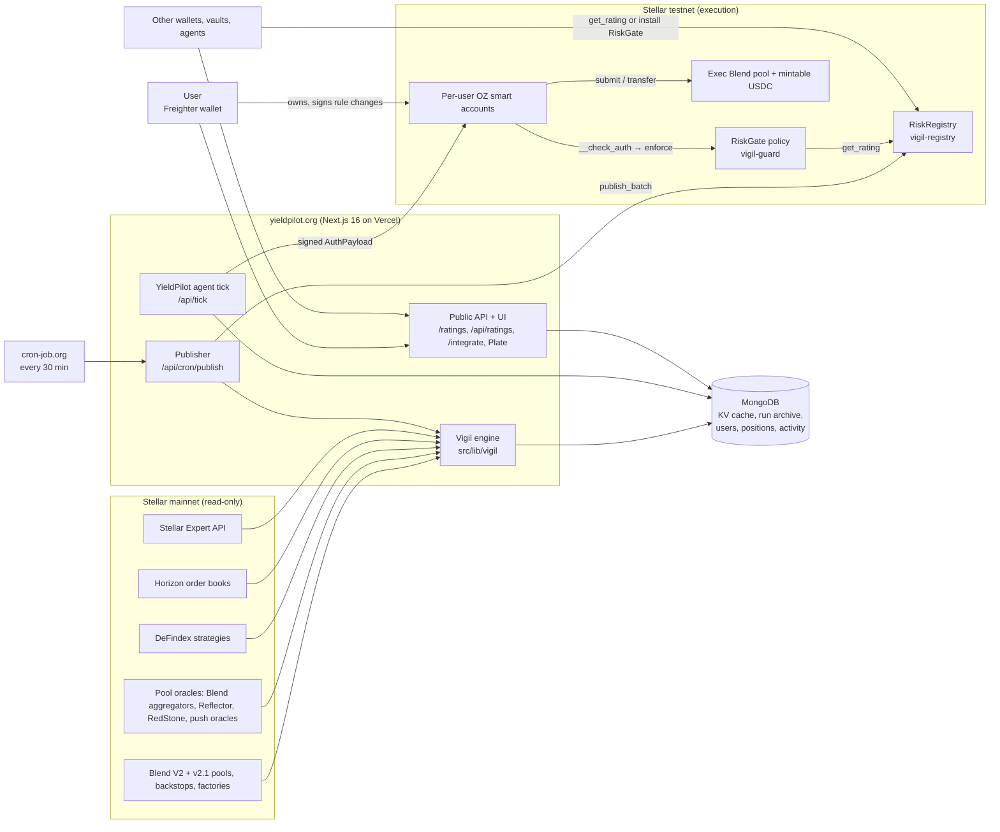
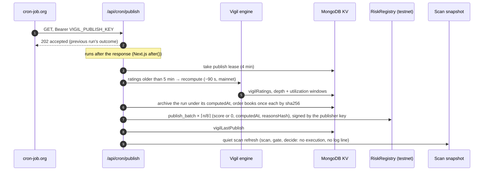
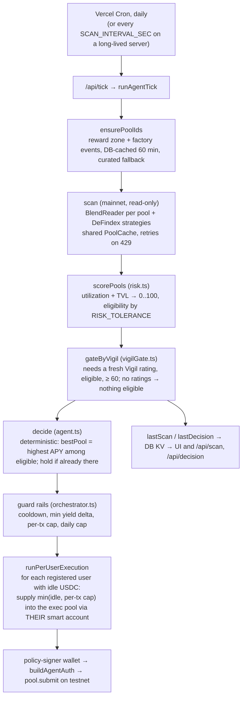

# Vigil + YieldPilot: Technical Architecture

**Status:** 2026-11-09. Engine `vigil-risk-v2.6.0`. Contracts and execution on Stellar **testnet**; pool scanning and ratings read Stellar **mainnet** (read-only). Source: [github.com/Goguzgungor/yieldpilot](https://github.com/Goguzgungor/yieldpilot), branch `feat/yieldseeker-mvp`, Apache-2.0. Live: [yieldpilot.org](https://yieldpilot.org).

This document describes how the system is built, for the Stellar Community Fund review and for anyone who wants to integrate or audit it. It links to the code and to the documents that go deeper: the rating methodology ([`docs/vigil/methodology.md`](vigil/methodology.md)), the contract reference ([`contracts/README.md`](../contracts/README.md)), the SCF application ([`builders/submission.md`](../builders/submission.md)) and the developer notes ([`CLAUDE.md`](../CLAUDE.md)).

---

## Contents

1. [What the system is](#1-what-the-system-is)
2. [System context](#2-system-context)
3. [Components](#3-components)
   - 3.1 [Vigil risk engine](#31-vigil-risk-engine)
   - 3.2 [Publisher and run archive](#32-publisher-and-run-archive)
   - 3.3 [RiskRegistry contract](#33-riskregistry-contract)
   - 3.4 [RiskGate contract](#34-riskgate-contract)
   - 3.5 [Smart accounts and the authorization model](#35-smart-accounts-and-the-authorization-model)
   - 3.6 [YieldPilot agent](#36-yieldpilot-agent)
   - 3.7 [Onboarding and ownership](#37-onboarding-and-ownership)
   - 3.8 [Web app, API and integration guide](#38-web-app-api-and-integration-guide)
   - 3.9 [SDK](#39-sdk)
4. [Data and state](#4-data-and-state)
5. [Infrastructure and operations](#5-infrastructure-and-operations)
6. [Security model and trust assumptions](#6-security-model-and-trust-assumptions)
7. [Testing and verification](#7-testing-and-verification)
8. [Deployed addresses](#8-deployed-addresses)
9. [Repository map](#9-repository-map)
10. [Roadmap: what the SCF deliverables change](#10-roadmap-what-the-scf-deliverables-change)
11. [Known limitations](#11-known-limitations)

---

## 1. What the system is

**Vigil** is a risk layer for lending pools on Stellar. It has three parts:

- an open-source **risk engine** that rates every Blend pool on mainnet (the V2 and v2.1 deployments) and the DeFindex strategies built on them, from on-chain configuration and market data: a score 0–100 (higher is safer), a grade A–E or NR, an eligibility verdict, the factors behind it, and a `reasonsHash` that commits to every input;
- **RiskRegistry**, a Soroban contract where registered publishers sign `(pool, score, timestamp, reasonsHash)` and readers get a conservative M-of-N aggregate;
- **RiskGate**, an OpenZeppelin smart-account *policy* (Soroban) that sits on the context rules a wallet gives an automated agent. It pins Blend calls to the account itself, allows only supply and withdraw request types, lets token transfers pay only the pool, and refuses a deposit into a pool whose aggregated rating is missing, stale or below the owner's minimum. Withdrawals are never blocked.

**YieldPilot** is the first consumer: an autonomous yield agent. One backend process scans Blend and DeFindex on mainnet, picks the highest-APY pool that passes its own risk checks *and* Vigil's gate, and supplies each registered user's idle USDC into it through that user's own OpenZeppelin smart account. In those accounts the agent is only a restricted, spending-capped signer, and RiskGate enforces the rating on-chain, so a bug or a stolen agent key cannot route funds to a weak pool or to any address but the user's own account.

The motivating event is the YieldBlox pool exploit of 22 February 2026 (about $10.9M): one collateral priced from a thin SDEX order book, pushed ×100 and held for two oracle rounds. The engine reconstructs that configuration and grades it E, not eligible ([methodology §8](vigil/methodology.md#8-backtest-yieldblox-before-22-feb-2026)).

---

## 2. System context



Two ideas organise everything:

1. **Dual network.** Everything that *reads* yields and risk reads mainnet; everything that *moves money* runs on testnet, against a Blend pool and a USDC token the team deployed. The agent decides on a mainnet pool and executes into the single testnet pool. Config is split the same way: every `SCAN_*` value is mainnet, every `EXEC_*` value is testnet ([`src/lib/config.ts`](../src/lib/config.ts)).
2. **Per-user execution (the "ARMA" model).** The agent decides once per tick, then executes once per user, inside each user's own smart account and within that account's on-chain rules. There is no pooled vault and the backend holds no user funds.

---

## 3. Components

### 3.1 Vigil risk engine

Code: [`src/lib/vigil/`](../src/lib/vigil/). Specification: [`docs/vigil/methodology.md`](vigil/methodology.md). The engine is pure TypeScript with all I/O injected, so the whole pipeline runs offline in tests and every rating is reproducible from its snapshot.

**Pipeline** (`engine.ts` `runVigil`):

```
discover pools ──► snapshot each pool ──► ratePool ──► pathsToGrades ──► rate DeFindex strategies
(per deployment)   (live.ts, mainnet)     (score.ts)   (whatif.ts)       (defindex.ts, worst-of)
```

- **Discovery** (`vigil/discovery.ts`): per Blend deployment, the factory's full `deploy` event history from Stellar Expert (the same method as DefiLlama's adapter) plus the backstop reward zone and recent events over RPC. Every candidate is verified with the factory's own `is_pool`, so an indexer error cannot inject a foreign contract.
- **Snapshot** (`live.ts`): Blend SDK `PoolV2.load` for status, admin, oracle, backstop rate and reserves; per-asset `lastprice` from the pool oracle, read one asset at a time; the backstop named in the pool's own config (`pool_data`); oracle attribution from the aggregator's `oracles()` / `asset_configs()`, the WASM spec and Stellar Expert metadata (`oracle.ts`); Horizon `/order_book` against classic USDC, **only** for collateral priced from an SDEX-derived feed. Every contract read is a `simulateTransaction` of a view call from a dummy account. Nothing is signed.
- **Scoring** (`score.ts` `ratePool`): a weighted sum of seven sub-scores, then hard rules that cap the score and decide eligibility.

| Factor | Weight | What it measures |
|---|---|---|
| `oracle_source` | 0.18 | Worst price-source quality across collateral (base 100 … issuer push 45, opaque 25, missing 0; −10 for `max_dev = 0`, −10 for an inferred source) |
| `oracle_freshness` | 0.12 | 0 if any collateral or borrowed asset has a missing or stale price, else 100 |
| `sdex_manipulation` | 0.23 | Worst ρ (attacker cost per dollar extracted) across SDEX-priced collateral, on the thinnest book of the last 24 h |
| `backstop_coverage` | 0.06 | Effective backstop (`5·usdc·(1−q4w)`) over USD liabilities |
| `utilization` (liquidity) | 0.24 | Per reserve, the better of the borrow ratio and the withdrawable USD; the weakest reserve counts |
| `supply_caps` | 0.12 | Borrow power a weakly priced collateral can create relative to available liquidity |
| `collateral_concentration` | 0.05 | HHI of collateral value |

Grade bands: A ≥ 80, B ≥ 65, C ≥ 50, D ≥ 35, E < 35. **NR** (not rated) for a pool that never launched or holds under $10K; nothing is published for it, so RiskGate refuses deposits as for any unrated pool.

**Hard rules** (full table and the reasoning behind each in [methodology §5](vigil/methodology.md#5-hard-rules)): HR1 frozen status, HR2 stale or missing price (≤ D), HR3 profitable SDEX manipulation (E), HR4 score under 50, HR5 unidentifiable price source (≤ C), HR8 backstop queue past Blend's own freeze share, HR10 lenders locked in (a reserve at or past its `max_util` with under $1M withdrawable, now or in any read of the last 6 h; ≤ C) all make a pool **not eligible**. HR6, HR7 and HR9 (weak collateral source, uninsured backstop, under 1 % first-loss capital) share one soft ceiling that compresses scores above 65 into 65–79, so such pools top out at B but keep their order.

**The SDEX manipulation model** (`manipulation.ts`) prices the YieldBlox attack pattern: buy out the asks up to `P·M` for each target multiplier `M`, hold the price for the rounds the aggregator's `max_dev` check needs (two, because both deployed aggregators compare only consecutive prices), post collateral at the inflated price and borrow the pool's other reserves. `ρ = (collateral cost + sweep cost) / extractable value`; `ρ < 1` is a profitable attack. The 24 h window keeps earlier books (at most one per asset per 50 minutes), rescaled to today's price, and the thinnest sets the factor.

**Windows that need history.** HR3's 24 h depth window and HR10's 6 h utilization window read the books and reserve reads this publisher stored on earlier runs (`depthHistory.ts`, `utilizationHistory.ts`, KV keys `vigilDepthHistory` / `vigilUtilHistory`; files for the CLI). They are attached to the snapshot, so they are hashed and archived with it. An empty utilization store is rebuilt from the archived runs.

**`reasonsHash`** = `sha256(canonicalJson({engineVersion, inputs, factors, hardRules, score, uncappedScore, grade, eligibleForDeposit}))`. `inputs` (`score.ts` `hashInputs`) are the status, oracle, chain time, backstop id and `pool_data`, each reserve's configuration, amounts, prices and source, and the sha256 of every order book used, including the 24 h window. Canonical JSON (`canonical.ts`): sorted keys, no whitespace, non-integers rounded to 6 decimals, bigint as string. `computedAt` is excluded, so the same snapshot always gives the same hash, and the engine version is inside it, so a hash also identifies the methodology.

**DeFindex** (`vigil/defindex.ts`): a strategy's rating is its underlying pool's (worst-of), with the pool and asset read from the strategy's on-chain `Config`; the strategy's TVL comes from `Reserves.total_b_tokens·b_rate`. A strategy whose asset is not an enabled reserve is not eligible. DeFindex's own contract and keeper risk is not modelled, and each rating says so.

**Paths** (`whatif.ts`): each rating carries the smallest set of protocol-side levers (backstop, oracle, caps, fresh prices) after which the engine itself would give B or A. They are computed by applying the lever to the snapshot and re-scoring, and are informational (not hashed).

### 3.2 Publisher and run archive

Code: [`src/lib/vigil/publish.ts`](../src/lib/vigil/publish.ts), [`src/lib/vigil/audit.ts`](../src/lib/vigil/audit.ts), [`src/lib/runtime.ts`](../src/lib/runtime.ts) (`publishVigilRatings`, `archiveRun`), route [`src/app/api/cron/publish/route.ts`](../src/app/api/cron/publish/route.ts).



Rules the publisher follows:

- **What is signed.** For every rated pool: `(pool, registryScore, computedAt, reasonsHash)`. `registryScore` is the engine's score when the pool is eligible for deposits and **0** when a hard rule holds it back, because the registry has no eligibility field and a pool at HR10's cap of 64 would otherwise pass a RiskGate minimum of 60. The `reasonsHash` is the rating's either way, so the real score stays verifiable. NR pools are not published. `computedAt` is mainnet chain time; the registry rejects future timestamps and anything older than its `max_age`.
- **The exec-pool stand-in.** YieldPilot executes every deposit into one testnet pool. That pool gets the rating of the mainnet pool YieldPilot currently holds (score, or 0 when not eligible), so the RiskGate on the testnet wallets checks the rating the agent routed by. With no position, or an NR pool, nothing is published and the gate refuses.
- **Archive.** Each run's ratings JSON is stored with every pool's full snapshot (order books replaced by their sha256) and the books once each, under the `computedAt` the registry returns. Runs are kept 90 days; a book is dropped when no kept run names it. `GET /api/ratings/runs?at=<computedAt>` serves one run with everything it was computed from.
- **Verification.** `npx tsx scripts/vigil-verify.ts [computedAt]` needs no keys: it recomputes every `reasonsHash` from the archived input, re-rates every pool with the checked-out engine, and compares with each publisher's submission in the registry (`audit.ts` `verifyRun`).
- **Cadence and hosting.** An external scheduler (cron-job.org) calls the route at :00 and :30, because Vercel's Hobby plan runs crons at most daily. The route answers 202 immediately and does the work in `after()`, with a 4-minute lease in the KV so two instances never publish the same run. The GitHub Actions workflow [`vigil-publish.yml`](../.github/workflows/vigil-publish.yml) is a manual backup that runs the same code (`scripts/vigil-publish.ts`). A full run costs about 0.0037 XLM in fees.

### 3.3 RiskRegistry contract

Crate: [`contracts/vigil-registry`](../contracts/vigil-registry/src/lib.rs). Shared types and the read interface: [`contracts/vigil-interface`](../contracts/vigil-interface/src/lib.rs). Reference, error codes and encodings: [`contracts/README.md`](../contracts/README.md).

```rust
__constructor(admin, threshold: u32 /* 1..=16 */, max_age_secs: u64 /* > 0 */)

// admin only
add_publisher(publisher)  remove_publisher(publisher)   // at most 16
set_threshold(threshold)  set_max_age(max_age_secs)
transfer_admin(new_admin)                               // current and new admin both authorize

// registered publishers only
publish(publisher, pool, score: u32, timestamp: u64, reasons_hash: BytesN<32>)
publish_batch(publisher, Vec<RatingInput>)             // 1..=32, atomic

// reads (RiskRegistryInterface)
get_rating(pool) -> Option<Rating { score, publishers, timestamp }>
get_submission(pool, publisher) -> Option<Submission { score, timestamp, reasons_hash }>
publishers() threshold() max_age() admin()
```

Aggregate semantics of `get_rating`, designed to be read inside smart-account auth:

- only submissions from **currently registered** publishers count (removing a publisher drops its submissions at once; re-adding restores the still-fresh ones);
- only **fresh** submissions count: `now − timestamp ≤ max_age`;
- `None` unless at least `threshold` such submissions exist (fail-closed; the threshold may exceed the publisher count);
- `score` is the **lower median**, `publishers` the count used, `timestamp` the **oldest** counted, so a consumer's freshness check bounds every input.

A submission replaces that publisher's previous one for the same pool only if strictly newer; `score ≤ 100`, no future timestamps, nothing already older than `max_age`. Config lives in instance storage, submissions in persistent storage under `(pool, publisher)` with the TTL extended 30 days on every publish; reads never extend TTL, which keeps the guard's call cheap. Every change emits an event (`rating_published`, `publisher_added`, `publisher_removed`, `threshold_set`, `max_age_set`, `admin_transferred`). Error codes 4200–4210.

Testnet deployment: threshold 1, `max_age` 7200 s, one publisher (a key that can only publish). Section 10 describes the v1.1 changes (engine version and eligibility flag on-chain) and the M-of-N operation.

### 3.4 RiskGate contract

Crate: [`contracts/vigil-guard`](../contracts/vigil-guard/src/lib.rs). It implements `stellar_accounts::policies::Policy` (OpenZeppelin `stellar-accounts` 0.8.0) and is deployed **once**, shared by every smart account, with no admin and no upgrade path. Parameters are stored per `(smart_account, context_rule_id)`:

```rust
RiskGateParams {
  registry: Option<Address>,      // None = no rating gate (account pinning still applies)
  min_score: u32,                 // 0..=100; must be 0 when registry is None
  max_age_secs: u64,              // > 0 when registry is set
  allowed_recipients: Vec<Address> // token rules: who `transfer` may pay; empty = nothing; ≤ 8
}
```

`install` and `uninstall` are called by the smart account when the owner adds or removes the policy (`add_policy` / `add_context_rule` / `remove_policy`). `enforce` runs inside the account's `__check_auth` for every call the agent signs under the guarded rule, in this order:

1. The account itself must be the invoker (`smart_account.require_auth()`).
2. **Every** signer of the rule must be among the authenticated signers, and there must be at least one (4104). A rule with policies hands its signer check to the policies, so this keeps the guard from ever loosening a rule.
3. Params must exist for `(account, rule id)` (4100).
4. The context must be a contract call (4105) to the rule's own `CallContract` target (4106).
5. Dispatch on the function name:

| Function | Allowed when |
|---|---|
| `submit`, `submit_with_allowance` (Blend pool) | `from == spender == to == account` (4109); non-empty requests (4110); each request strictly `{address, amount, request_type}` (4108); `request_type ∈ {0 Supply, 1 Withdraw, 2 SupplyCollateral, 3 WithdrawCollateral}` (4111); `amount ≥ 0` (4112). If any request is a deposit (0 or 2) and a registry is set: `get_rating(pool)` must return a rating (4114), with `score ≥ min_score` (4115) and `now − timestamp ≤ max_age_secs` (4116). **Withdraw-only requests are never rating-gated.** |
| `claim` (Blend pool) | `from == to == account` (4109) |
| `transfer` (token) | `from == account` (4109); `to ∈ allowed_recipients` (4113); `amount ≥ 0` (4112); a muxed recipient is rejected (4108) |
| anything else (`approve`, `transfer_from`, `flash_loan`, borrow, auctions, …) | never (4107) |

The rating is looked up for the **called contract** (the pool in the context), not for anything in the arguments. Effective freshness is `min(registry.max_age, guard.max_age_secs)` measured from the oldest submission the registry used. Every decision emits `risk_gate_enforced {rule id, contract, fn_name, deposit, score}`. Error codes 4100–4116; a policy error comes back unchanged from `__check_auth` (for example `Error(Contract, #4115)`), and the SDK decodes it.

On YieldPilot's wallets the guard is installed on both agent rules: the pool rule with `{registry, min_score 60, max_age 7200 s, no recipients}` and the USDC rule with `{no registry, min_score 0, recipients [exec pool]}` next to OpenZeppelin's spending-limit policy.

### 3.5 Smart accounts and the authorization model

Each user owns an OpenZeppelin `SmartAccount` (the deployed 0.7.x wasm, `e2f4ed54…a28d`) on testnet. Its rules:

```
Default rule   owner:  Signer::Delegated(user's G-account)      ── the user signs in Freighter
rule "agent-pool"  CallContract(Blend exec pool)
    signer:   Signer::External(ed25519 verifier, agent public key)
    policy:   RiskGate {registry, min_score 60, max_age 7200 s}
rule "agent-usdc"  CallContract(USDC SAC)
    signer:   the same agent key
    policies: spending limit (5,000 USDC per 17,280 ledgers ≈ 1 day), RiskGate {recipients: [pool]}
```

For wallets created since 2026-11-01 the backend holds **no owner key**: deploying the wallet, adding or removing the agent's rules and finalizing ownership are ordinary Freighter `signTransaction`s. The seven wallets created before that were owned by a backend demo key; on 2026-11-02 each got the guard on both agent rules and its user as co-owner ([21 transactions](legacy-migration-2026-11-02.md)), and the backend key leaves when the user signs "Finalize ownership" in the app.

**How the agent signs** ([`src/lib/smartAccount.ts`](../src/lib/smartAccount.ts) `buildAgentAuth`, proven first in `scripts/spike-*.ts`):

```mermaid
sequenceDiagram
  autonumber
  participant A as Agent (backend)
  participant RPC as Soroban RPC (testnet)
  participant SA as User smart account
  participant G as RiskGate
  participant R as RiskRegistry
  participant SL as Spending limit
  participant B as Blend exec pool

  A->>RPC: simulate pool.submit(SA, SA, SA, [Supply]) with recording auth
  RPC-->>A: auth entries (the SA's own entry; __check_auth mocked)
  A->>A: payload = sha256(HashIdPreimage.sorobanAuthorization)<br/>digest = sha256(payload ‖ xdr(ScVec[rule ids]))<br/>ed25519 sign, signature = Map{context_rule_ids, signers}
  A->>RPC: re-simulate the SIGNED tx, assemble footprint + resources
  A->>RPC: submit
  RPC->>SA: __check_auth(payload, signature, contexts)
  SA->>G: enforce(pool context, signers, rule "agent-pool", SA)
  G->>R: get_rating(pool)
  R-->>G: Some{score, publishers, timestamp}
  G-->>SA: ok (deposit: score ≥ min_score, fresh)
  SA->>SL: enforce(usdc.transfer(SA → pool, amount)) — cap
  SA->>G: enforce(usdc context, rule "agent-usdc") — recipient = pool
  SA->>B: submit → Supply
```

The two-pass simulation matters: the first recording simulation mocks `__check_auth`, so its footprint omits the context-rule reads and the verifier and registry cross-contract calls. The signed transaction is simulated again and assembled so the final footprint and resources are right. This is why the `Wallet` abstraction has an optional `submitOp` that owns the whole round-trip instead of a single-pass `signXdr`.

For owner actions through the Delegated signer (step 2 of onboarding), `buildDelegatedOwnerTx` puts `AuthPayload{[0], {Delegated(G): b""}}` on the smart account's entry and adds the nested `SA.__check_auth(authDigest)` authorization as a **source-account** entry, which the user's envelope signature covers. On the 0.7 wasm the nested argument is `sha256(payload ‖ xdr(ScVec[rule ids]))`, proven by `scripts/spike-delegated-owner.ts` and end-to-end by `scripts/verify-onboarding-owner.ts`.

### 3.6 YieldPilot agent

Code: [`src/lib/runtime.ts`](../src/lib/runtime.ts) (`tick`), [`src/lib/orchestrator.ts`](../src/lib/orchestrator.ts) (`runTick`, `runPerUserExecution`), [`src/lib/scanner.ts`](../src/lib/scanner.ts), [`src/lib/defindex.ts`](../src/lib/defindex.ts), [`src/lib/risk.ts`](../src/lib/risk.ts), [`src/lib/vigilGate.ts`](../src/lib/vigilGate.ts), [`src/lib/agent.ts`](../src/lib/agent.ts), [`src/lib/executor.ts`](../src/lib/executor.ts), [`src/lib/wallet.ts`](../src/lib/wallet.ts).



Points that matter:

- **Decision is deterministic.** `bestPool` is the highest-APY pool among those eligible after both checks; `agent.ts` composes the rationale, naming the choice and the best higher-yield pool it excluded. There is no model call on the tick path (one was removed in 2026-10 for cost; it only ever applied the same rule).
- **Vigil's gate is applied twice.** Off-chain in the agent's choice (`gateByVigil`, from the cached ratings the publisher keeps fresh; the tick never recomputes them), and on-chain by RiskGate on every wallet. If no pool passes, the agent holds and idle USDC stays idle: supplying would add to a position it can no longer route to. Leaving a pool that became ineligible is a risk move and skips the minimum yield delta.
- **Vigil also widens the scan.** Pools Vigil rates as depositable are added to the agent's candidates (`vigilCandidatePools`), which is how the agent sees Blend v2.1 pools its own discovery does not enumerate.
- **Guard rails are enforced twice.** Off-chain (`PER_TX_CAP_USDC`, `DAILY_CAP_USDC`, `MIN_YIELD_DELTA_BPS`, `REBALANCE_COOLDOWN_SEC`) and on-chain by the spending-limit policy and RiskGate.
- **Execution targets one testnet pool** whatever mainnet pool won; multi-pool execution is future work. One user's failure is logged and does not stop the others.
- **Cadence.** On Vercel the tick runs daily (`vercel.json`); a long-lived server (`next dev`, `next start`) runs it every `SCAN_INTERVAL_SEC` from `instrumentation.ts`. After every publish the publisher runs a **quiet** scan refresh (scan, gate, decide; no execution, no position or ledger write, no log line), so the homepage follows the 30-minute ratings instead of the daily tick. "Refresh" in the UI only re-reads the cached snapshot.
- **Nothing touches env or SDK clients at import time.** Everything is lazy so `next build` and route analysis work with an empty environment; `AGENT_LOOP_ENABLED=0` disables the loop for tests, CI and builds.

### 3.7 Onboarding and ownership

Code: [`src/lib/onboarding.ts`](../src/lib/onboarding.ts) (client-safe, no SDK), [`src/app/api/onboard/prepare`](../src/app/api/onboard/prepare/route.ts) and [`submit`](../src/app/api/onboard/submit/route.ts) (server-side build, simulate and assemble), [`src/app/api/register`](../src/app/api/register/route.ts), [`src/lib/ownerAuth.ts`](../src/lib/ownerAuth.ts), [`src/lib/faucet.ts`](../src/lib/faucet.ts).

| Step | What the user signs in Freighter | What happens on-chain |
|---|---|---|
| 1 Deploy | an account-signed transaction | `createCustomContract` of the OZ smart account with `Signer::Delegated(G)` as its Default-rule owner; deterministic contract id returned |
| 2 Authorize ×2 | two transactions, owner-authorized through the Delegated signer | `add_context_rule(CallContract(pool))` with the agent key and RiskGate; `add_context_rule(CallContract(USDC))` with the agent key, the spending-limit policy and RiskGate. The new rule ids come back from the calls |
| 3 Fund | an account-signed transaction | `usdc.transfer(owner → smart account)`; or the faucet mints testnet USDC into the account (`/api/faucet`, admin = SEP-5 key from `STELLAR_WALLET_MNEMONIC`) |
| 4 Register | a SEP-53 `signMessage` of `ownerMessage()` | nothing on-chain: `POST /api/register` records `{owner, smartWallet, poolRuleId, usdcRuleId}`; the signature is checked within 5 minutes, 401 otherwise. `DELETE` is protected the same way |

The browser bundle never imports the Stellar SDK: the server returns an unsigned, fully prepared XDR, the client signs it and posts it back. `finalize-ownership` is the fifth step for the seven migrated wallets: it removes the backend demo owner, co-signed by the backend for exactly that call. `/api/authorize` (the old backend-owned path) answers 410. `/api/reset` answers 404 unless `RESET_KEY` is set, which production does not set.

### 3.8 Web app, API and integration guide

Next.js 16 App Router, React 19, all routes `force-dynamic`.

- **Plate I** ([`src/app/_components/PlateApp.tsx`](../src/app/_components/PlateApp.tsx)): one night sky. The lower part is a dithered stipple range drawn on canvas where every summit is a scanned pool (x = risk rank, height = APY relative to the scan, width = TVL depth; excluded pools dissolve into fog past the risk-cap line; the route summit carries a column of light). The upper part shows one view at a time: visitor or holder overview, a selected pool, setup, account, history. Pure geometry and copy live in `src/lib/plate/` and `src/lib/voice.ts` and are unit-tested; the canvas engine rebuilds the print only when the scan signature or viewport changes and honours `prefers-reduced-motion`. State is plain polling (position and activity every 3 s, scan every 15 s).
- **`/ratings`**: every pool's grade, score, factors, hard rules, current supply and borrow APR, and what would raise it to B or A.
- **`/integrate`** and **`/integrate.md`** ([`src/lib/integrate/`](../src/lib/integrate/)): a guide for other projects with three paths, the honest limits of each, a live check of a pool against a chosen minimum, an on-chain `get_rating` call from the browser, and a brief to hand to an AI coding assistant. Snippets use `@stellar/stellar-sdk` and `soroban-sdk` directly; the SDK package is not published.

| Route | Purpose |
|---|---|
| `GET /api/ratings` (`?inputs=1`, `?refresh=1`) | Vigil ratings from the cache; `inputs=1` adds every snapshot, strategy input and order book. CORS `*` |
| `GET /api/ratings/runs` (`?at=<computedAt>`) | archived runs of the last 90 days, one run with all its inputs. CORS `*` |
| `GET /api/cron/publish` | the publisher (Bearer `VIGIL_PUBLISH_KEY`), 202 then work |
| `GET` / `POST /api/tick` | the agent tick (Bearer `CRON_SECRET` when set) |
| `GET /api/scan`, `/api/decision`, `/api/position`, `/api/activity`, `/api/users`, `/api/agent` | cached scan, last decision, position, activity log, registered users, the agent's public keys |
| `POST /api/onboard/prepare`, `/api/onboard/submit`, `GET /api/onboard/ownership` | onboarding transactions and ownership state |
| `POST` / `DELETE /api/register` | per-user registration with SEP-53 owner signature |
| `POST /api/faucet` | testnet USDC mint into a smart account |

Money is always stroops (`bigint`, 7 decimals) inside the server; JSON carries amounts as decimal strings (`src/lib/serialize.ts`).

### 3.9 SDK

[`packages/vigil-sdk`](../packages/vigil-sdk/) (`@yieldpilot/vigil-sdk` 0.1.0, private, peer dependency `@stellar/stellar-sdk ≥ 14`):

- `guard.ts`: `riskGateParams`, `poolRuleParams`, `tokenRuleParams` (the exact ScMap encoding with sorted symbol keys), `policiesMap`, `addPolicyOp`, `VIGIL_ERRORS` and `decodeVigilError`;
- `registry.ts`: `RegistryClient` (`getRating`, `getSubmission`, `publishBatchOp`, …) over a read server;
- `ratings.ts`: typed `fetchRatings` for the JSON API.

The app itself uses it (`smartAccount.ts`, `publish.ts`), so the SDK is exercised on every tick and publish. Publishing it on npm with a guide is deliverable 3.3.

---

## 4. Data and state

State is **MongoDB when `MONGODB_URI` is set, in-memory otherwise** (tests and bare local runs). Both back the same interfaces ([`src/lib/db.ts`](../src/lib/db.ts), [`src/lib/registry.ts`](../src/lib/registry.ts), [`src/lib/mongo.ts`](../src/lib/mongo.ts)). On Vercel the daily tick, the publisher and a user's `/api/register` run in different function instances, so nothing the loop and the routes both touch may live only in process memory.

| Store | Contents |
|---|---|
| collection `users` | `{owner, smartWallet, poolRuleId, usdcRuleId}` per registered user |
| collection `positions` | each smart wallet's position `{poolId, amount}` (stroops as decimal string) |
| collection `position`, `activity`, `rebalances` | the shared agent's legacy singleton position, the activity log (what the UI's voice and history read), the daily-cap ledger |
| collection `kv` | every key below: one document per key, JSON or gzip-packed values |
| KV `lastScan`, `lastScanAt`, `lastDecision` | the scored, gated scan and the decision, for the UI and the API |
| KV `discoveredPools`, `discoveredAt` | pool discovery cache (60-minute TTL; merged, never dropping a known pool) |
| KV `vigilRatings`, `vigilRatingsAt`, `vigilRatingsRefreshAt` | the ratings cache (served at once; recomputed in the background past 1 h; 5-minute refresh lease) |
| KV `vigilDepthHistory`, `vigilUtilHistory` | the 24 h order-book window and the 6 h utilization window |
| KV `vigilRunIndex`, `vigilRun:<computedAt>`, `vigilBookIndex`, `vigilBook:<sha256>` | the run archive, gzip-packed, 90 days; books stored once |
| KV `vigilPublishAt`, `vigilLastPublish` | publish lease and the last outcome (txs, failures, stand-in note) |

The database name is still `yieldseeker` (the project's former name); it stays on purpose, as does the demo-owner key seed `yieldseeker-demo-owner:v1`, which changing would orphan every migrated smart account.

---

## 5. Infrastructure and operations

| Concern | How |
|---|---|
| Hosting | Vercel (Hobby), Next.js 16, Node runtime; `yieldpilot.org` DNS at Cloudflare pointing to Vercel. Pushes to `feat/yieldseeker-mvp` deploy production |
| Scheduling | Vercel Cron: `/api/tick` daily at 00:00 UTC. cron-job.org: `/api/cron/publish` every 30 minutes (Hobby crons are daily at most). GitHub Actions `vigil-publish.yml`: manual backup publisher |
| Long routes | `maxDuration = 300` on the ratings, publish and tick routes; the heavy work runs in `after()` so callers with short timeouts still start a full run |
| RPC | mainnet `SCAN_RPC_URL` (public RPC answers 429 past a burst: one `PoolCache` per scan, retries in `rpcRetry.ts`, 120 ms spacing in the engine); testnet `EXEC_RPC_URL` |
| Secrets | `AGENT_SIGNER_SECRET` (the one agent key on every wallet; a Sensitive Vercel variable, so it cannot be pulled), `VIGIL_PUBLISHER_SECRET` (testnet key that can only publish ratings), `VIGIL_PUBLISH_KEY` (bearer for the publish route), `STELLAR_WALLET_MNEMONIC` (faucet admin), `MONGODB_URI`, optional `CRON_SECRET`, `RESET_KEY` (unset in production) |
| Configuration | `parseConfig` (zod) in `config.ts`; most contract ids have defaults baked in so a bare `.env` boots; `VIGIL_REGISTRY_ID=off` disables the rating gate; `WALLET_MODE=keypair` keeps the legacy single-signer path |
| Observability | the activity log (`/api/activity`), `lastPublish` on `/api/ratings/runs` (txs, failures, stand-in), `console.warn` for every pool a scan drops, registry and guard events on-chain |
| Licensing | Apache-2.0 for the app, engine, contracts and SDK |

---

## 6. Security model and trust assumptions

| Threat | What stops it | Residual |
|---|---|---|
| **Stolen or misused agent key** | The agent is only an External signer under two context rules. RiskGate pins `submit`/`claim` to `from = spender = to = account`, allows only supply and withdraw request types, lets `transfer` pay only the pool, and refuses every other function. The spending-limit policy caps USDC per period. Proven on testnet: before the guard the agent key withdrew a user's position to an attacker (`afd85af7…`); with it, that call fails `#4109`, a direct transfer `#4113`, a borrow `#4111`, a deposit at a low rating `#4115` ([contracts/README](../contracts/README.md#migrating-an-existing-yieldpilot-account-testnet)) | The agent can still `usdc.transfer(SA → pool)` directly without a `submit`, donating up to the cap to the pool with nothing credited (a submit-scoped ticket closes this in RiskGate v1). It can churn supply/withdraw |
| **Compromised backend** | The backend holds no owner key for wallets created since 2026-11-01; owners sign rule changes in Freighter. Registration and deletion need the owner's SEP-53 signature. Execution is bounded by the same on-chain rules as above | The seven migrated wallets keep the backend demo key as co-owner until each user finalizes ownership |
| **Routing into a weak pool** | Off-chain: the agent only considers pools with a fresh, eligible Vigil rating ≥ 60. On-chain: RiskGate checks `get_rating` for the called pool on every deposit. Not-eligible pools are signed at 0, NR pools are not signed, so no minimum accepts them | The engine's windows depend on the publisher's own reads (§9.1 of the methodology); a publisher without 24 h of history rates some pools differently |
| **Compromised or lazy publisher** | Every published hash can be recomputed from the archived inputs by anyone (`vigil-verify.ts`); the registry takes M-of-N with a lower median and the oldest timestamp; a removed publisher stops counting at once | The testnet registry is **1-of-1** with one key and a single-key admin. T2 makes it ≥ 3 publishers at threshold 2 with a multisig admin |
| **Stale or unavailable registry** | Deposits fail closed (`#4114`, `#4116`); withdrawals never depend on the registry | A stalled publisher stops new deposits |
| **Oracle manipulation of a pool** | Modelled explicitly (ρ on the thinnest 24 h book, two-round hold); a profitable attack is grade E and not eligible | Partial book coverage (Horizon USDC book, 200 levels, no AMM) and attacker-friendly simplifications: the model errs toward flagging |
| **Contract bugs** | RiskGate has no admin and no upgrade path; 79 contract tests plus a compatibility suite against the **deployed** OpenZeppelin 0.7 account wasm with real ed25519 signatures and no mocked auth | Fixing a guard bug means a new deployment and each owner running `remove_policy` + `add_policy`. An external audit (Audit Bank) is T2/T3 |
| **Methodology drift** | Every engine version is documented with its reason; the version is inside every `reasonsHash` | The registry entry does not carry the version yet, so an owner's minimum changes meaning when the methodology changes; RiskRegistry v1.1 stores version and eligibility on-chain |

What the user must trust today: the publisher set (one key, the team's), the registry admin (one key), the OpenZeppelin account and policy code, and Blend itself. What the user does **not** have to trust: the YieldPilot backend with their funds, the agent key beyond the rules above, or yieldpilot.org's server to tell the truth about a rating (the archive makes every rating recomputable).

---

## 7. Testing and verification

| Layer | What runs | How |
|---|---|---|
| Unit (TypeScript) | 558 tests in 63 files, offline and deterministic: engine (every factor and hard rule, hashing, archive and verification, publisher rules, DeFindex, what-if paths, backtest), agent (orchestrator, risk, gate, cadence), auth (owner message, ownership, smart-account encodings), plate geometry and copy, SDK | `npm test` (vitest; no `MONGODB_URI`, RPC faked, loop disabled) |
| Contracts (Rust) | 79 tests plus 1 ignored: registry aggregate semantics, every guard error path, and `tests/sa_compat.rs`, which registers the **real** `oz_smart_account_0_7.wasm` and spending-limit wasm, adds the rules with the guard, and calls `try_invoke_contract_check_auth` with a real ed25519 signature over the 0.7 digest and no mocked auth. The ignored test repeats the core cases with the compiled guard and registry wasms | `cd contracts && cargo test`, `stellar contract build`, `cargo test -- --ignored` |
| On-chain proofs (testnet) | the drain-before / blocked-after table in `contracts/README.md` (`scripts/verify-guard.ts`), user-owned onboarding end to end (`scripts/verify-onboarding-owner.ts`), delegated owner auth (`scripts/spike-delegated-owner.ts`), per-user execution (`scripts/verify-peruser.ts`), the legacy migration of seven wallets (`docs/legacy-migration-2026-11-02.md`) | `npx tsx scripts/<file>.ts` with a populated `.env` |
| Live data | mainnet ratings (`scripts/vigil-ratings.ts`, ~90 s), mainnet scan and discovery (`npm run verify:blend-mainnet`, `verify:discovery`), DeFindex reads | read-only |
| Published ratings | `scripts/vigil-verify.ts [computedAt]`: recompute every hash of an archived run, re-rate, compare with the registry; no keys needed | anyone, from a clone |
| Backtest | the YieldBlox pool reconstructed as of 2026-02-22 00:00 UTC from admin events and 53,537 replayed pool events: grade E, not eligible | `scripts/vigil-backtest.ts` (offline) |
| Load | a resumable driver for 97 testnet wallets over 24 h with its own database and agent key, with preflight guards and an exporter ([`scripts/loadtest/README.md`](../scripts/loadtest/README.md)) | `npx tsx scripts/loadtest/*.ts` |
| Typecheck | `npx tsc --noEmit`; `next build` uses `tsconfig.build.json` | |

`src/app/**` is excluded from the unit-test glob on purpose: logic lives in `src/lib`, components stay thin.

---

## 8. Deployed addresses

**Testnet (execution, contracts)**

| | Id |
|---|---|
| RiskRegistry (`vigil-registry`) | `CB4LXLCCD7YDND5FBVXPKPHUQMF7JFSDRVXHG7ZZTWWNPJ6WDCXDNDF6` — threshold 1, `max_age` 7200 s, wasm `7213dcc0…a2b66` |
| RiskGate (`vigil-guard`) | `CD6BDS7R5K3IUCQSJUZUWAGLTR47EZOYEVCO5MPT7YGNBNQRHSNY5VMS` — wasm `10279cd9…09987` |
| Publisher key (can only publish) | `GAIY6WF2F24DCGDWGWOJCBQHDMMGU6JUKT7LIGYBZ4C5VFCKTFCLJJFD` |
| Registry admin (deployer, throwaway) | `GANUB45L4U3YYHZDSEJEVMLSBVXCKBIRLP3ZPE3PANUWMVI4UKBGQH3C` |
| Exec Blend V2 pool | `CBI7WAUQ4NPQFZW4C3MDSVFAZJWV3RCLZSTTMA5OZ6BTPEQMOZZNSZ3Z` |
| Exec USDC (SAC, mintable) | `CD2R7WREEPGIAXZL4ASB76Y6PWTY6ZZXZ6C64AIKFDIG36YKQPNY6B2I` |
| OZ ed25519 verifier | `CBHJOANTAHF2ZKU5HZRZTWP4GX7YCSNR3V3AIMAH5P5R7S465SK24RSO` |
| OZ spending-limit policy | `CBLNG63CIFKLFY6ZTL32NWMGPN7NBDSXZUSCQNTLMYRTLIZYA7MG3KAP` |
| OZ smart-account wasm | `e2f4ed54b009c6b1c5bd848e4c73ff706c74d9436757859423f8959fa4aca28d` (0.7.x) |

**Mainnet (read-only sources)**

| | Id |
|---|---|
| Blend V2 pool factory / backstop | `CDSYOAVXFY7SM5S64IZPPPYB4GVGGLMQVFREPSQQEZVIWXX5R23G4QSU` / `CAQQR5SWBXKIGZKPBZDH3KM5GQ5GUTPKB7JAFCINLZBC5WXPJKRG3IM7` |
| Blend v2.1 pool factory / backstop | `CACUXRNBUFV7BFPKUDLVJFQI6H7EHHNSJPOFJSCWJCYUUYMORM6C63AL` / `CCS4AZ5ORM6VLLPJTJUFRNXWBMHOO3L5WHHRPL2ZMILE35ZDMQFHOQMJ` |
| USDC (Circle SAC) | `CCW67TSZV3SSS2HXMBQ5JFGCKJNXKZM7UQUWUZPUTHXSTZLEO7SJMI75` |
| Reflector Stellar-DEX feed / CEX feed | `CALI2BYU2JE6WVRUFYTS6MSBNEHGJ35P4AVCZYF3B6QOE3QKOB2PLE6M` / `CAFJZQWSED6YAWZU3GWRTOCNPPCGBN32L7QV43XX5LZLFTK6JLN34DLN` |
| DeFindex strategies rated | four configured in `SCAN_DEFINDEX_STRATEGIES` (USDC, EURC and XLM Fixed; USDC Etherfuse) |

Toolchain: soroban-sdk 28.0.0, stellar-accounts 0.8.0, stellar CLI 26.0.0, target `wasm32v1-none`; `@stellar/stellar-sdk` 15.1, `@blend-capital/blend-sdk` 3.2, Next.js 16, React 19, TypeScript 6, vitest 4, MongoDB driver 7.

---

## 9. Repository map

| Path | What |
|---|---|
| `src/lib/vigil/` | the risk engine: `engine.ts` (pipeline), `score.ts` (factors, hard rules, hashing), `manipulation.ts`, `oracle.ts`, `discovery.ts`, `live.ts` (mainnet readers), `defindex.ts`, `whatif.ts`, `depthHistory.ts`, `utilizationHistory.ts`, `audit.ts` (archive and verify), `publish.ts` (publisher), `service.ts` (live wiring), `backtest.ts`, `canonical.ts`, `types.ts` |
| `src/lib/` | the agent: `config.ts`, `runtime.ts` (process singleton, tick, caches, archive), `orchestrator.ts`, `discovery.ts`, `scanner.ts`, `defindex.ts`, `risk.ts`, `vigilGate.ts`, `agent.ts`, `executor.ts`, `wallet.ts`, `smartAccount.ts`, `onboarding.ts`, `ownerAuth.ts`, `ownership.ts`, `legacyMigration.ts`, `faucet.ts`, `db.ts`, `registry.ts`, `mongo.ts`, `serialize.ts`, `plate/`, `voice.ts`, `integrate/` |
| `src/app/` | Next.js UI (`_components/PlateApp.tsx`, `plate/`, `views/`), pages `/`, `/ratings`, `/integrate`, and the API routes under `api/` |
| `contracts/` | `vigil-guard`, `vigil-registry`, `vigil-interface` (Rust); `testdata/` holds the real OZ wasms the compatibility tests run against; `README.md` is the contract reference |
| `packages/vigil-sdk/` | the TypeScript client |
| `scripts/` | testnet and mainnet proofs (`verify-*.ts`, `spike-*.ts`), deploy and migration scripts, `vigil-ratings.ts`, `vigil-publish.ts`, `vigil-verify.ts`, `vigil-backtest.ts`, `loadtest/` |
| `docs/vigil/methodology.md` | the rating methodology: inputs, factors, hard rules, live results, backtest, limitations, version history |
| `docs/legacy-migration-2026-11-02.md` | the 21 transactions that guarded and handed over the seven legacy wallets |
| `docs/superpowers/` | design specs and plans of the major features |
| `builders/` | the SCF application packet (`README.md` is its index; `submission.md` the application) |
| `.github/workflows/vigil-publish.yml` | the manual backup publisher |
| `CLAUDE.md` | developer notes: commands, the two organising ideas, conventions and gotchas |

---

## 10. Roadmap: what the SCF deliverables change

The application ([`builders/submission.md`](../builders/submission.md), "Deliverables") funds the work that turns this architecture from a single-team testnet system into a multi-publisher mainnet one. Architecturally:

| Deliverable | Change to the system |
|---|---|
| 1.1 Ratings service v1 | every archived run copied to a permanent, content-addressed public store outside the deployment; `vigil verify <run>` in the SDK; every DeFindex factory vault and strategy enumerated and rated; a 14-day availability measurement |
| 1.2 Methodology v1.0 | a public review of the methodology (≥ 3 weeks), a specification of how a new publisher warms up its 24 h and 6 h windows and how far two publishers may disagree, three backtests with published inputs |
| 1.3 RiskRegistry v1.1 | each submission carries the **engine version** and an **eligibility flag**; `get_rating` returns both, so an owner's minimum can be pinned to a methodology and a not-eligible pool is refused by the flag instead of a 0 |
| 2.1 RiskGate v1 | refuses ratings flagged not eligible or from a version the owner did not accept; a submit-scoped ticket closes the direct-transfer gap; DeFindex vault deposit and withdraw support; tested against a `stellar-accounts` 0.8 account, whose auth digest differs from the deployed 0.7 one; code freeze in week 10 |
| 2.2 Audit readiness | Audit Bank application on the frozen code with threat model, invariants and test report |
| 2.3 M-of-N operation | testnet registry at threshold 2 with ≥ 3 publishers on separate keys and hosting (at least one outside Vercel) and a multisig admin; publisher client and runbook so an outside organisation joins by registering one key; 30 days of measured publishing and a published agreement comparison |
| 3.1–3.2 Mainnet | RiskRegistry and RiskGate on mainnet after the audit; ≥ 3 publishers live for 14 days |
| 3.3–3.4 SDK v1 and integrations | the SDK on npm with a `smart-account-kit` example; RiskGate offered upstream to ≥ 2 open-source Stellar wallet or vault codebases |
| 3.5 YieldPilot mainnet beta | a capped beta (≤ $500 per user, ≤ 50 users) through RiskGate on mainnet, on `stellar-accounts ≥ 0.8` accounts: the first real-funds use of the gate |

---

## 11. Known limitations

Stated here so a reader does not have to infer them; the detailed versions are in [methodology §9](vigil/methodology.md#9-known-limitations-and-assumptions) and [contracts/README "Known limitations"](../contracts/README.md#known-limitations--residual-risk).

- **Testnet only** for execution, the registry and RiskGate. Mainnet is read-only. The only callable rated testnet pool is YieldPilot's own exec pool, which carries the rating of the mainnet pool YieldPilot holds.
- **One publisher, one admin key** on the registry. The contract supports 16 publishers and a threshold; the operation does not exist yet (deliverable 2.3).
- **Ratings depend on the publisher's own history** for the 24 h and 6 h windows, and cannot be recomputed from the chain alone, because Horizon keeps no past order books. The archive makes them recomputable from our record.
- **The registry entry carries no engine version and eligibility only as a 0** (deliverable 1.3).
- **RiskGate's direct-transfer gap** (donation to the pool within the cap) and **churn** are open until RiskGate v1.
- **No multi-pool execution**: every deposit goes to the single exec pool.
- **No contract-level risk** of pools, oracles or DeFindex (upgradeability, admin keys) is modelled beyond the oracle class.
- **The methodology changed six times in two days** (v2.0 → v2.5, 2026-11-01/02) and once more on 2026-11-04 (v2.6, the team's own change, breaking the announced v2.5 freeze). Every change is documented with its reason in methodology §10, and the version is inside every hash.
- **Migration in flight** in the state layer: `db.ts` and `registry.ts` are async Mongo implementations and a few `runtime.ts` accessors still assume the older synchronous shapes.
